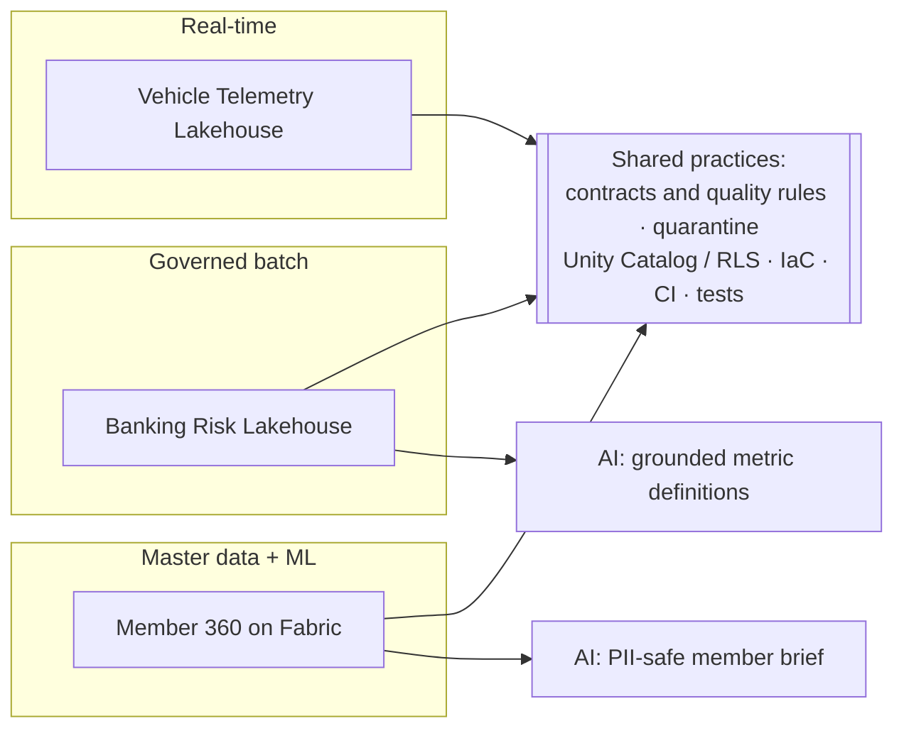

# Enterprise Data Engineering Portfolio

**Venkata Narendra Kumar Sykam** · Senior Azure Data Engineer · 8+ years building governed data platforms for banking, financial services and connected products. Open to new opportunities.

[Portfolio site](https://sykamsolutions.com) · [GitHub](https://github.com/SykamVenkata)

These three projects each tackle a different hard problem a data platform team faces: governed batch analytics, real-time streaming, and master data with ML on top. Each one runs end to end on a laptop, has CI, and includes the Terraform and deployment files to stand it up in Azure or Microsoft Fabric. All data is synthetic.

## Flagship projects

### 1. [Azure Banking Risk Lakehouse](https://github.com/SykamVenkata/azure-banking-risk-lakehouse)
**Problem:** Risk, finance and treasury each computed NPL ratio, roll rate and loss allowance differently, in overnight spreadsheets.
**Built:** A governed Azure lakehouse that gives every consumer (Power BI, SQL and an AI assistant) one certified answer.

- Data contracts drive the Auto Loader schema, quality rules and PII masking from one YAML file
- Rows that fail a rule go to quarantine, not into Gold. Credit-risk fields (DPD buckets, NPL, CECL staging, roll rate) are recomputed rather than trusted from the source
- BCBS 239-style reconciliation decides whether Gold gets published
- A governed metrics catalog maps each KPI to its Power BI measure, and an Azure OpenAI index over those definitions lets an assistant cite its source

`ADF` `Databricks` `Delta Lake` `Unity Catalog` `Power BI (PBIP/TMDL)` `Azure OpenAI` `Vector Search` `Terraform` `Asset Bundles`

### 2. [Real-time Vehicle Telemetry Lakehouse](https://github.com/SykamVenkata/realtime-vehicle-telemetry-lakehouse)
**Problem:** Fleet operators need to see vehicle health within a minute, even though connected-vehicle data arrives late, duplicated and malformed.
**Built:** A streaming lakehouse from Event Hubs to live Power BI. It also runs locally with Kafka in one command.

- Structured Streaming with watermarks, so late readings correct their minute instead of being dropped
- Exactly-once results from checkpoints, `dropDuplicatesWithinWatermark` and idempotent MERGE
- 13 quality rules with a quarantine table, column masks on GPS data, and a check that the Spark and Python versions of the rules agree

`Event Hubs / Kafka` `Structured Streaming` `Delta Lake` `Unity Catalog` `Power BI` `Terraform` `Docker`

### 3. [Credit Union Member 360 on Fabric](https://github.com/SykamVenkata/credit-union-member360-fabric)
**Problem:** Core banking, insurance and investment systems share no member key, so nobody knows how many products a member holds or who is about to leave.
**Built:** Cross-system identity resolution into one golden member, with BI, ML and AI on top.

- Identity matching across the three systems: 100% precision and 98% recall, measured against ground truth
- A churn model (AUC 0.88, 4.5x top-decile lift) and next-best-product offers that check eligibility
- AML rules for structuring and rapid money movement, kept out of front-line tools
- A dbt gold layer on Fabric Warehouse, a Direct Lake model with row-level security, and a PII-safe brief for a service copilot

`Microsoft Fabric` `OneLake` `PySpark` `dbt` `MLflow` `scikit-learn` `Power BI (Direct Lake)` `Fabric data agent` `Terraform`

## How they fit together

## Skills shown

| Area | Where |
|---|---|
| Azure Data Factory, Fabric data pipelines | Banking · Member 360 |
| Databricks, Spark, Delta Lake (batch and streaming) | Banking · Telemetry |
| Microsoft Fabric (Lakehouse, Warehouse, Direct Lake, data agent) | Member 360 |
| Data modeling (Kimball star schema, SCD Type 2) | Banking · Member 360 |
| Data quality, contracts, reconciliation | All three |
| Governance (Unity Catalog, column masks, row-level security, PII) | All three |
| dbt (models, tests, freshness) | Member 360 |
| ML engineering (features, MLflow, model cards) | Member 360 |
| GenAI readiness (embeddings, retrieval, guardrails) | Banking · Member 360 |
| Power BI (DAX, TMDL, Direct Lake) | Banking · Member 360 · Telemetry |
| Terraform, Databricks Asset Bundles, GitHub Actions | All three |

## Domain depth

- **Banking and credit risk:** NIM, NPL, delinquency roll rates, CECL / IFRS 9 staging, risk-weighted assets
- **Credit unions:** Member 360, multi-domain product penetration, retention, AML typologies
- **Connected vehicles:** streaming telemetry, alerting, fleet KPIs
